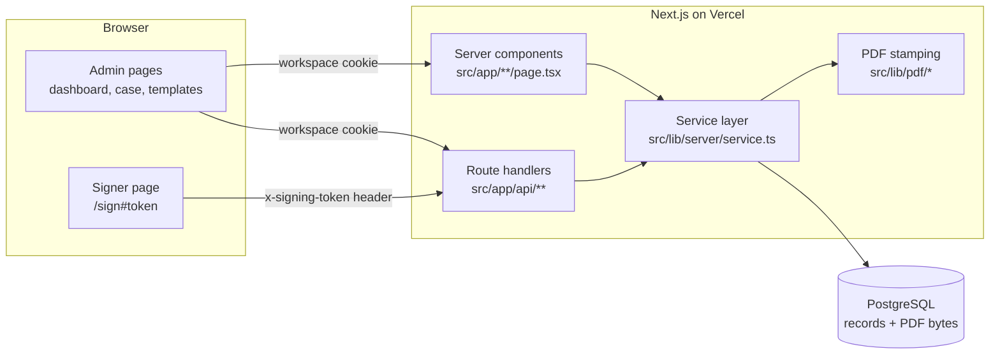
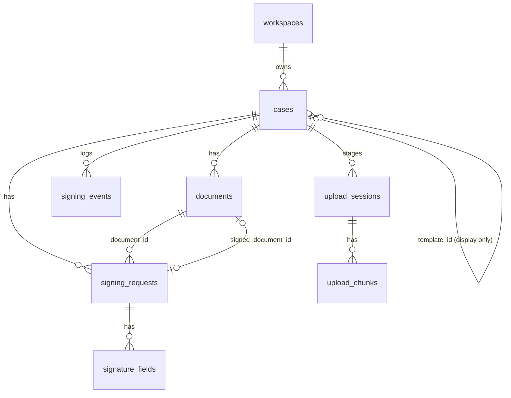
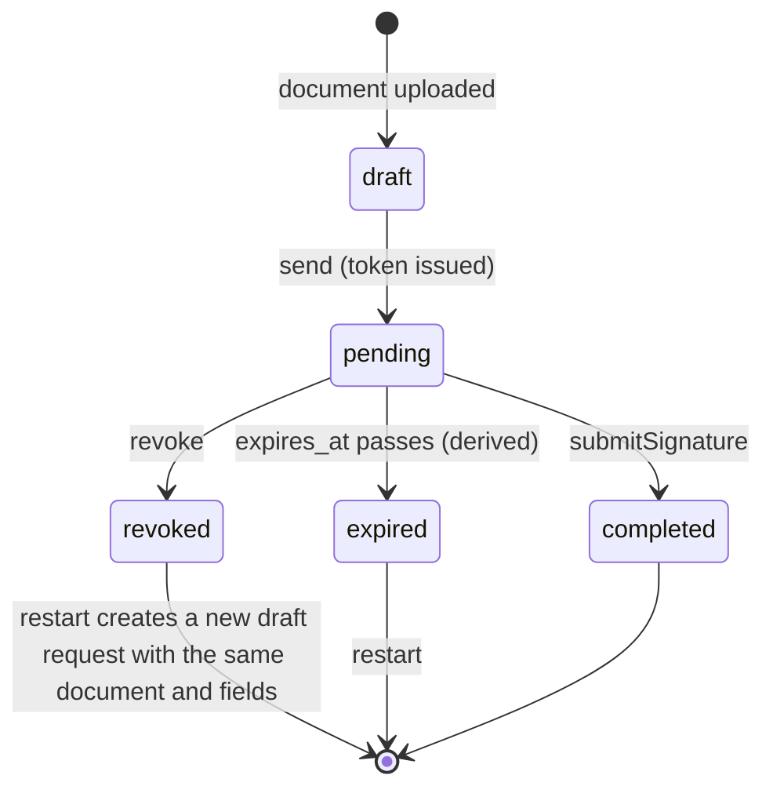

# Architecture

This describes the implemented system. File references point to the code that enforces each statement.

## System overview

FileSign is a single Next.js 16 App Router application deployed on Vercel, backed by one PostgreSQL database (Neon in production). There is no separate object store, queue or email provider.



## Component boundaries

| Layer | Location | Responsibility |
|---|---|---|
| Pages | `src/app/{page,dashboard,cases/[caseId],templates,sign}` | Server-rendered admin pages, always dynamic (they read live DB state). The signer page renders on the client because the token lives in the URL fragment. |
| Client components | `src/components/*` | PDF viewer (`PdfPages`), field editor with serialized autosave (`FieldEditor`), upload with chunking (`UploadForm`), signer app and signature pad, link panel. |
| Route handlers | `src/app/api/**/route.ts` | Parse and validate input (Zod schemas in `src/lib/schemas.ts`), resolve the caller (workspace or signing token), call the service layer, map `HttpError` to responses (`src/lib/server/http.ts`). |
| Service layer | `src/lib/server/service.ts` | All database access, workspace scoping, transactions, signing. |
| Session and crypto | `src/lib/server/session.ts`, `crypto.ts` | Demo workspace cookie, hashing, token encryption. |
| Limits | `src/lib/limits.ts`, `src/lib/server/limits.ts` | Rate-limit counters, storage quota, upload-session caps. |
| PDF | `src/lib/pdf/coordinates.ts`, `stamp.ts`, `unicode-fonts.ts`, `decrypt.ts` | Coordinate contract, stamping and certificate, Unicode text, owner-password decryption. |
| State | `src/lib/signing/state.ts` | Request state machine and effective status (including derived expiry). |

### API routes

| Route | Caller | Purpose |
|---|---|---|
| `POST /api/workspace` | anyone | Create a demo workspace and set its cookie. |
| `POST /api/cases` | workspace | Create a case, optionally from a template. |
| `POST /api/cases/[caseId]/document` | workspace | Single-request upload (up to 3 MB). |
| `POST /api/cases/[caseId]/uploads`, `PUT /api/uploads/[uploadId]/chunks/[index]`, `POST /api/uploads/[uploadId]/complete` | workspace | Chunked upload (3 MB parts) for larger files. |
| `GET /api/documents/[documentId]` | workspace | Stream an original or signed PDF. |
| `PUT /api/requests/[requestId]/fields` | workspace | Replace the field layout (autosave). |
| `POST /api/requests/[requestId]/send`, `/revoke`, `/restart` | workspace | Issue the link; revoke it; start a new request after revoke or expiry. |
| `POST /api/templates`, `DELETE /api/templates/[templateId]` | workspace | Create or delete a template. |
| `POST /api/sign/view`, `GET /api/sign/document`, `POST /api/sign/submit` | signing token | Signer view data; original or signed PDF; submit the signature. |

## Data model and tenant scoping

Migrations live in `db/migrations/` (`001_init`, `002_upload_sessions`, `003_templates`, `004_abuse_limits`).



- **`workspaces`**: a self-service demo tenant. Only the SHA-256 hash of the cookie secret (`session_hash`) is stored.
- **`cases`**: `kind` is `client` or `template`. `template_id` references the source template with `on delete set null` and is used for display only.
- **`documents`**: `kind` is `original` or `signed`. PDF bytes are stored in `content` (`bytea`) with `sha256`, `size_bytes` and `page_count`.
- **`signing_requests`**: `status` is `draft`, `pending`, `completed` or `revoked`. It also holds `token_hash` (unique), `token_ciphertext`, `expires_at` and `signed_document_id`. The check constraints are `completed_has_artifact` (completed implies a signed document and a completion time) and `pending_has_token`.
- **`signature_fields`**: `kind` is `signature`, `name` or `date`. It stores `page_index` and `x`, `y`, `width`, `height` normalized to 0–1, enforced by check constraints.
- **`signing_events`**: the append-only audit log, with `event_type`, `actor` (`admin`, `signer` or `system`), `occurred_at`, `ip_hash`, `user_agent` and `metadata` (jsonb).
- **`upload_sessions` and `upload_chunks`**: staging for chunked uploads.
- **`rate_limit_counters`**: fixed-window counters keyed by `(bucket, window_start)`.

**Tenant scoping.** Every row hangs off `cases.workspace_id`, and deletes cascade from the workspace. Each admin service function takes the caller's `workspaceId`, and every query joins through `cases.workspace_id`. A foreign ID therefore returns 404, and a missing session returns 401 (`requireWorkspace()` in `session.ts`).

## Cases, templates and snapshot-on-use

A template is a `cases` row with `kind = 'template'`. It reuses the normal document, upload, viewer and field-editor paths. Its field layout lives on a draft `signing_requests` row that can never be sent, revoked or restarted (409).

Creating a case from a template (`createCase` with `templateId`) runs in one transaction:
1. It locks the template's draft request (`for update`).
2. It requires a PDF and at least one signature field (409 otherwise).
3. It checks the storage quota for the copied bytes (413 otherwise).
4. It inserts the case, a **new** `documents` row with a copy of the PDF bytes (same SHA-256), and a **new** draft request with copies of the fields.
5. It logs `document_from_template`.

After that the case shares no mutable rows with the template. Editing or replacing the template PDF, moving its fields or deleting the template never changes existing cases, pending links or signed artifacts. Templates never appear in the case list, and `/cases/<template id>` returns 404.

## Signing request state machine



- `expired` is not stored; `effectiveStatus()` derives it from `expires_at`. Expiry is enforced when the link is used. Links expire after 14 days (`LINK_TTL_DAYS`).
- There are no transitions out of `completed`.
- Dashboard stages are display-only. **Draft** means no PDF or no signature field, and **Ready** means a link can be created. Pending, Completed, Expired and Revoked follow the request status.

## PDF pipeline

### Upload and validation
`validatePdfUpload` checks:
- the extension or MIME type;
- `%PDF-` within the first 1 KB;
- a full parse of every page;
- at most 300 pages and 25 MB.

Owner-password PDFs (restrictions only) are decrypted with `@cantoo/pdf-lib` (`decrypt.ts`), and the decrypted copy becomes the case original; the event records both hashes. PDFs that need a password to open are rejected. Files over 3 MB use chunked upload, because Vercel caps request bodies at about 4.5 MB. Assembled files go through the same validation. Replacing a draft PDF deletes the replaced original only if no request references it.

### Preview
PDF.js (legacy build) renders pages in the browser. The worker, standard fonts, CMaps, wasm decoders and ICC profiles are copied into `public/pdfjs` by `postinstall` (`scripts/copy-pdfjs-assets.mjs`). PDF responses are streamed, because buffered responses over about 4.5 MB fail on Vercel.

### Coordinate mapping
`src/lib/pdf/coordinates.ts` is the single contract between viewer and server:
- **Browser:** the pointer position is normalized against the page overlay's bounding box (`clientToNorm`), in the *displayed* page space with a top-left origin and the page rotation applied. This makes it independent of zoom, CSS size, devicePixelRatio and scroll.
- **Server:** `pageGeometry` computes the visible box (CropBox ∩ MediaBox) and the normalized `/Rotate`. `normRectToPdf` then maps the normalized rectangle to PDF user-space points.

Unit tests cover all four rotations, CropBox offsets and a page-2 regression.

### Stamping
`stampPdf` (`stamp.ts`):
- wraps each page's existing content in `q … Q`, so an unbalanced transform in the original can't shift the stamp;
- draws the signature PNG fitted (contain) inside its rectangle, rotated with the page so it reads upright;
- draws name and date text;
- appends a US Letter certificate page with the document, case, sender, signer name, signer email (marked "not verified"), method, consent text, UTC events, request ID, original SHA-256 and hashed signer IP.

The original pages are otherwise unchanged.

### Unicode text
Name and date text uses standard Helvetica when WinAnsi can encode it. Otherwise it uses OFL Noto Sans or Noto Sans SC (`assets/fonts/`), subset per string with HarfBuzz (`harfbuzzjs`) and embedded through `@pdf-lib/fontkit` (`unicode-fonts.ts`). Characters neither font covers become `?`. A font failure falls back to `?` rather than blocking signing.

## Signing tokens and authorization

```mermaid
sequenceDiagram
  participant Admin
  participant Server
  participant DB
  participant Signer
  Admin->>Server: POST /api/requests/:id/send (cookie)
  Server->>DB: store sha256(token), AES-256-GCM(token), expires_at; status=pending
  Server-->>Admin: https://host/sign#token
  Admin-->>Signer: share link (copy or mail app)
  Signer->>Server: POST /api/sign/view (x-signing-token)
  Server->>DB: lookup by sha256(token)
  Signer->>Server: POST /api/sign/submit (x-signing-token, consent, PNG)
  Server->>DB: one transaction: lock, check, stamp, insert signed doc, complete, log
  Server-->>Signer: completed
```

- **Tokens** are 256-bit random values. Lookup uses only their SHA-256 hash. An AES-256-GCM copy keyed from `APP_SECRET` lets the admin re-copy a pending link, and it is cleared on completion or revoke.
- **The token sits in the URL fragment.** Browsers never send fragments to servers or in `Referer`, so tokens stay out of access logs. The client sends the token only in the `x-signing-token` header.
- **Admin routes** require the workspace cookie: httpOnly, `SameSite=Lax`, and `Secure` in production. Signer routes never accept the cookie as authority, and admin routes never accept a token.
- **Invalid tokens** get a generic 404 with no reason. Server logs record only error messages, never URLs or tokens.

## Atomic signing and concurrency

`submitSignature` runs in one transaction:
1. It selects the request by token hash with `for update`, which serializes concurrent submissions.
2. It checks the state with `checkCanSign`: completed, revoked, expired or not-sent gives a 409 with a specific message.
3. It requires a signature field.
4. It logs `consent_given`.
5. It stamps the PDF in memory.
6. It inserts the signed `documents` row.
7. It sets `status = 'completed'` where the status is still `pending`.
8. It logs `document_signed` and `request_completed`.

If anything fails, everything rolls back and the signer can retry. A second submission waits for the lock, then gets a 409. Rejected attempts are logged as `signing_attempt_rejected`. The `completed_has_artifact` constraint is a second guard against a completed request without a file.

The other concurrency controls are row locks:
- Field saves and uploads lock the case's latest request.
- Template use locks the template request.
- The storage quota and upload-session cap are checked under a `for update` lock on the workspace row, so concurrent uploads can't both slip under the limit.

## Audit trail and integrity

- **Events:** `case_created`, `template_created`, `document_uploaded`, `document_from_template`, `request_created`, `signing_page_opened`, `consent_given`, `document_signed`, `request_completed`, `request_revoked`, `request_restarted`, `signing_attempt_rejected`, all written server-side only.
- **What each event stores:** a UTC timestamp, the actor, a keyed hash of the IP (never the raw IP), the user agent and metadata.
- **Hashes:** the original and signed PDFs are separate rows, each with a SHA-256. These are integrity fingerprints, not a cryptographic PDF signature.
- **Immutability:** signed documents and completed requests are never updated or deleted by the application.

## Rate limits, quotas and security controls

Constants are in `src/lib/limits.ts`. Counters are in Postgres, so all serverless instances share them. Each hit is a single `INSERT … ON CONFLICT DO UPDATE … RETURNING` on an hourly window aligned to the UTC hour.

| Control | Limit | Scope | On breach |
|---|---|---|---|
| New demo workspaces | 150 per hour | client IP (keyed hash) | 429 with `Retry-After`; the home page shows a fixed message |
| Upload starts | 60 per hour / 150 per hour | workspace / client IP | 429 with `Retry-After` |
| Stored PDF bytes | 150 MB | workspace (originals and signed) | 413 |
| Open chunked uploads | 3 | workspace | 429. A new upload on the same case replaces its unfinished session |
| Unfinished upload session | 60 minutes | session | 404, "start the upload again" |
| File size / pages / fields / signature image | 25 MB / 300 / 60 / 600 KB | request | 413 or 422 |

Signing endpoints are not rate-limited, because tokens are 256-bit and single-use.

**Headers** (`next.config.ts`, all routes):
- **CSP:** `default-src 'self'`.
  - `script-src` allows `'unsafe-inline'`, which the App Router bootstrap needs, and `'wasm-unsafe-eval'`, which the pdf.js decoders need. It never allows `'unsafe-eval'`; Zod runs jitless.
  - `worker-src` allows `'self'` and `blob:`, and `img-src` allows `data:` and `blob:`.
  - `object-src 'none'` and `frame-ancestors 'none'`.
- **Other headers:** HSTS (2 years, including subdomains), `Cross-Origin-Opener-Policy: same-origin`, `Referrer-Policy: no-referrer`, `X-Content-Type-Options: nosniff`, `X-Frame-Options: DENY`, and a `Permissions-Policy` that disables camera, microphone and geolocation.

## Deployment and migrations

- **Production deploys** are deliberate CLI deploys from a clean `main` (`vercel deploy --prod`). Git pushes don't deploy.
- **The build** (`vercel-build`) runs `npm run db:migrate` and then `next build`. `scripts/migrate.ts` applies each unapplied file in `db/migrations/` inside a transaction and records it in `schema_migrations`.
- **Migrations are additive.** The previous release must keep working on the migrated schema, so rollback means promoting the previous deployment without touching the database.
- **Previews must not deploy.** Preview deployments would share the production `DATABASE_URL` and run migrations against it.

## Invariants and failure handling

1. Every admin read and write is scoped by `workspace_id`. Cross-tenant IDs return 404.
2. A request is completed only together with its signed artifact and audit events, in one transaction.
3. A completed request can never be signed again, and signed artifacts are never mutated.
4. Signing tokens are stored only as a hash and an encrypted copy. They never appear in server logs, query strings or audit metadata.
5. Field coordinates are normalized to the displayed page and converted to PDF space only through `coordinates.ts`.
6. Template use copies data. Cases never share mutable rows with templates.
7. Migrations are additive and backward compatible with the previous release.
8. User-facing failures are explicit:
   - upload errors give a 4xx with a message;
   - a failed field save is shown with retry, and navigation waits for pending saves;
   - replacing a PDF with placed fields asks first;
   - a signer whose connection drops re-checks the request with the server instead of assuming success or failure.
